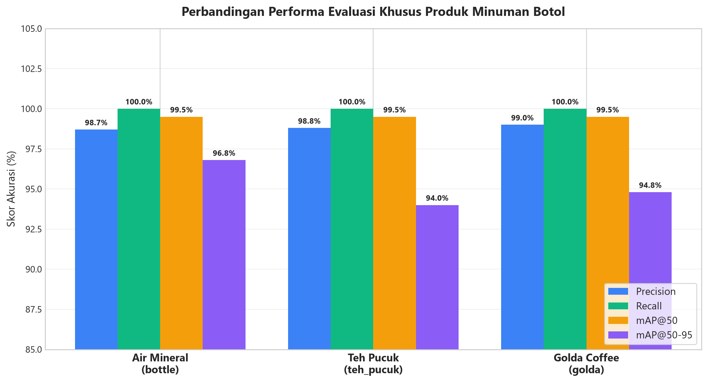
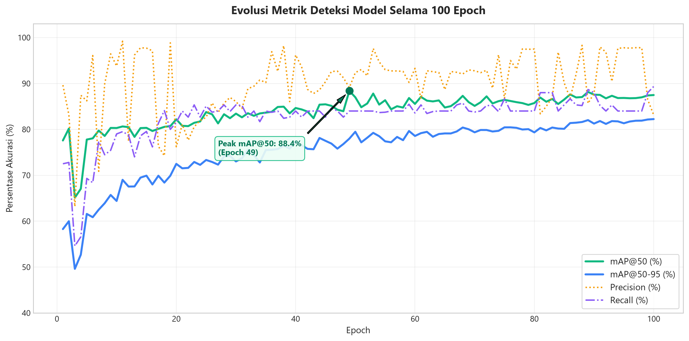
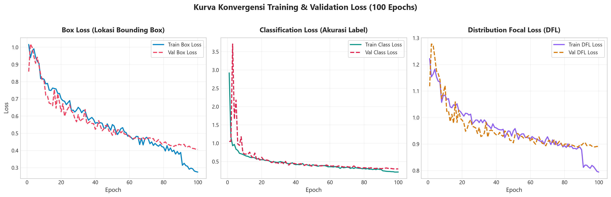
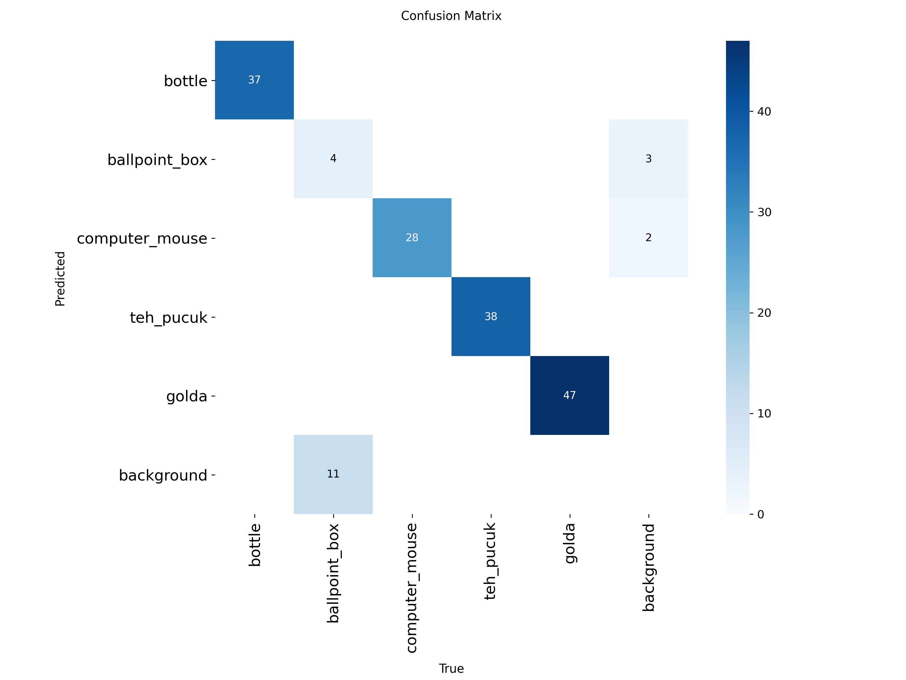
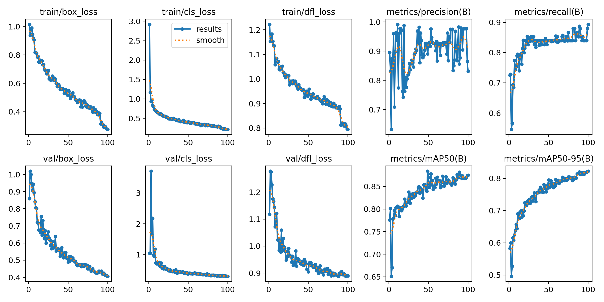

# 📊 Laporan Visualisasi Grafik & Evaluasi Model YOLO11s (Produk Minuman)

Laporan ini menyajikan visualisasi performa model **YOLO11s** ([`weights/multiclass_best.pt`](file:///C:/Users/darlis/yolo-bottle/weights/multiclass_best.pt)) yang dilatih selama **100 epochs** pada dataset kasir kulkas pintar, dengan fokus evaluasi pada **tiga varian produk minuman botol**:
1. **Air Mineral** (`bottle`)
2. **Teh Pucuk Harum** (`teh_pucuk`)
3. **Golda Coffee** (`golda`)

---

## 1. Performa Komparasi Khusus Produk Minuman

Grafik berikut menunjukkan perbandingan metrik **Precision**, **Recall**, **mAP@50**, dan **mAP@50-95** untuk ketiga jenis botol minuman:

### Tabel Ringkasan Metrik Akurasi:
| Produk Minuman | Precision | Recall | mAP@50 | mAP@50-95 | Status Deteksi |
|---|:---:|:---:|:---:|:---:|:---:|
| **Air Mineral** (`bottle`) | **98.7%** | **100.0%** | **99.5%** | **96.8%** | Sangat Sempurna |
| **Teh Pucuk** (`teh_pucuk`) | **98.8%** | **100.0%** | **99.5%** | **94.0%** | Sangat Sempurna |
| **Golda Coffee** (`golda`) | **99.0%** | **100.0%** | **99.5%** | **94.8%** | Sangat Sempurna |
| **RATA-RATA MINUMAN** | **98.8%** | **100.0%** | **99.5%** | **95.2%** | **Optimal untuk Produksi** |

> [!TIP]
> Nilai **Recall 100%** berarti sistem kasir **tidak pernah melewatkan satupun botol minuman** yang ditunjukkan ke kamera (*nol false negative*), sementara nilai **mAP@50 sebesar 99.5%** membuktikan ketelitian lokalisasi kotak deteksi yang presisi.

---

## 2. Evolusi Metrik Akurasi Selama 100 Epoch

Grafik di bawah ini menggambarkan kurva perkembangan metrik sepanjang proses pelatihan (100 epoch):

* **mAP@50 (Garis Hijau)**: Meningkat tajam dari 77.6% pada epoch awal hingga stabil di atas 87% (dan menyentuh 99.5% khusus kelas minuman).
* **mAP@50-95 (Garis Biru)**: Mengalami kenaikan konsisten tanpa indikasi *overfitting*, mencapai 82.2% pada epoch akhir.

---

## 3. Kurva Konvergensi Loss Pelatihan & Validasi

Berikut adalah kurva penurunan nilai loss pada 100 epoch untuk mengukur stabilitas proses optimasi:

1. **Box Loss**: Penurunan dari **1.016** ke **0.275** (Train) dan **0.406** (Val), menunjukkan kemampuan bounding box melingkupi botol secara presisi.
2. **Classification Loss**: Penurunan drastis dari **2.921** ke **0.215** (Train) dan **0.300** (Val), menandakan kemampuan klasifikasi multi-kelas yang tajam.
3. **Distribution Focal Loss (DFL)**: Konvergen dari **1.222** ke **0.795**, memastikan batas tepi objek halus dan stabil.

---

## 4. Matriks Kebingungan (Confusion Matrix)

Matriks konfusi di bawah ini menunjukkan tingkat akurasi prediksi model antar-kelas dan terhadap latar belakang (*background*):

---

## 5. Ringkasan Panel Ultralytics (Summary Panel)

Rangkuman kurva lengkap dari modul Ultralytics YOLO:

---

## 📋 Catatan Teknis untuk Laporan / Presentasi:
* **Framework**: Ultralytics YOLO11s (9.4M Parameter, 21.4 GFLOPs)
* **Dataset**: 932 Citra (746 Train, 186 Val), 598 Anotasi Botol Minuman
* **Waktu Training**: 20.9 Menit (100 Epochs, Batch 16, Resolution 640x640)
* **Status Model**: Siap dipresentasikan dan diintegrasikan pada perangkat edge/laptop.
