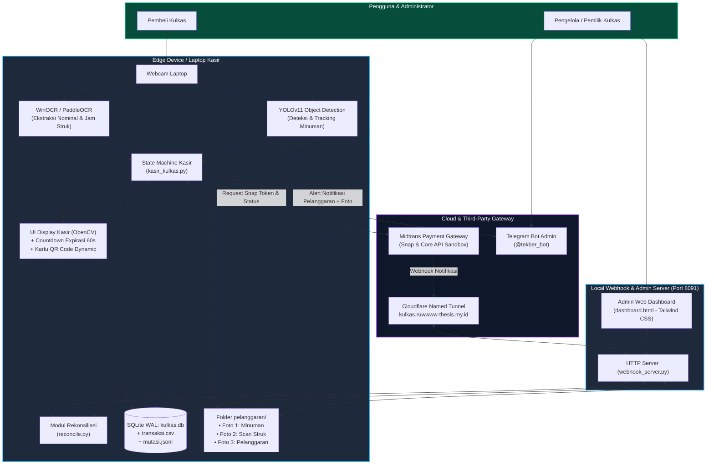
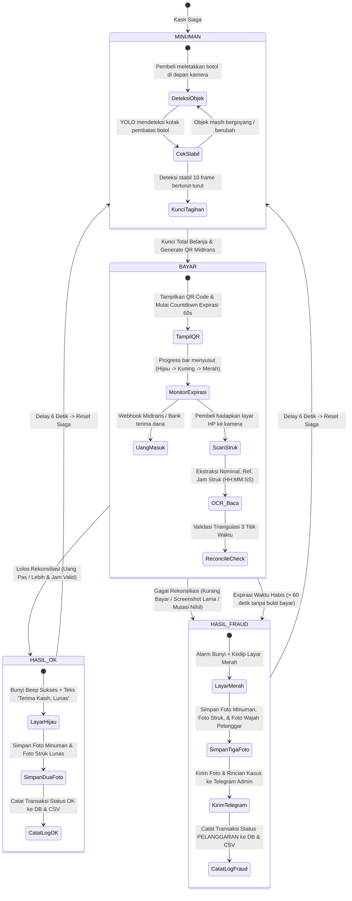
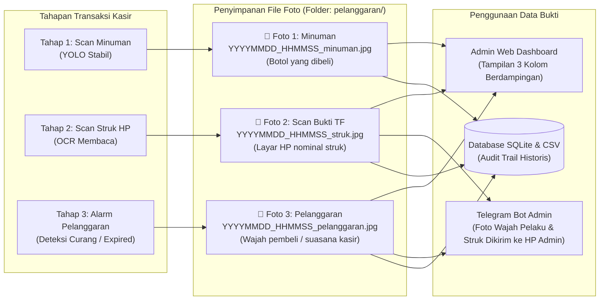

# Panduan Diagram Alur & Materi Visual (Laporan & PPT)
## Sistem Kasir Kulkas Kejujuran Berbasis YOLO, OCR Struk, QRIS Midtrans, & Rekonsiliasi Mutasi

Dokumen ini dirancang khusus untuk mempermudah penyusunan **Bab Pembahasan / Metodologi Laporan Skripsi/Tugas Akhir** dan pembuatan **Slide Presentasi (PPT)**. Semua diagram menggunakan format standar **Mermaid** yang dapat langsung di-render di Markdown viewer, GitHub, atau disalin ke tool visualisasi (Mermaid Live, Draw.io, Canva, PowerPoint).

---

## 1. Arsitektur Global Sistem (System Overview)

Diagram ini cocok untuk slide PPT: **"Arsitektur Sistem & Integrasi Komponen"**.



---

## 2. Alur Transaksi Kasir & State Machine

Diagram ini cocok untuk slide PPT: **"Alur Kerja Pengguna (User Flow) & Transisi State"**.



---

## 3. Logika Triangulasi Waktu & Rekonsiliasi Mutasi Anti-Kecurangan

Diagram ini adalah **kontribusi ilmiah utama** untuk Bab 3 & 4 (Metodologi & Analisis Sistem).

```mermaid
flowchart TD
    START([Data Masuk dari Kamera & Webhook]) --> IN_DATA[Input Data:<br/>1. Nominal Struk OCR<br/>2. Jam Struk OCR T_struk<br/>3. Jam Kamera Kasir T_kamera<br/>4. Database Mutasi Bank T_mutasi]

    IN_DATA --> C1{Lapisan 1: Validasi Nominal Dasar<br/>Apakah Nominal OCR >= Total Tagihan?}
    C1 -- Tidak --> F1[PELANGGARAN: UNDERPAYMENT<br/>Contoh: Tagihan Rp 10.000, Bayar Rp 3.000]

    C1 -- Ya --> C2{Lapisan 2: Validasi Jam Struk vs Kamera<br/>Apakah |T_struk - T_kamera| <= 180 detik?}
    C2 -- Tidak --> F2[PELANGGARAN: TIMESTAMP KADALUARSA<br/>Replay Attack / Screenshot Lama Kemarin]

    C2 -- Ya --> C3{Lapisan 3: Pencarian Mutasi Riil di MutationStore<br/>Apakah ada mutasi nominal sama & belum diklaim?}
    C3 -- Tidak --> F3[PELANGGARAN: MUTASI NIHIL<br/>Struk Palsu / Editan, Tidak Ada Uang Masuk]

    C3 -- Ya --> C4{Lapisan 4: Validasi Jam Struk vs Mutasi Masuk<br/>Apakah |T_mutasi - T_struk| <= 180 detik?}
    C4 -- Tidak --> F4[PELANGGARAN: MISMATCH JAM MUTASI<br/>Struk Orang Lain Dipinjam]

    C4 -- Ya --> C5{Lapisan 5: Anti Double-Spend<br/>Apakah Mutasi ID atau No. Ref Sudah Diklaim?}
    C5 -- Ya --> F5[PELANGGARAN: DOUBLE SPEND<br/>Satu Bukti Transfer Dipakai Dua Kali]

    C5 -- Tidak --> OK[STATUS: LUNAS TERVERIFIKASI<br/>Tandai Mutasi: claimed = True]

    F1 --> ALARM[Aktifkan Alarm + Simpan 3 Bukti Foto + Lapor Telegram]
    F2 --> ALARM
    F3 --> ALARM
    F4 --> ALARM
    F5 --> ALARM

    classDef valid fill:#065f46,stroke:#10b981,stroke-width:2px,color:#fff;
    classDef invalid fill:#881337,stroke:#f43f5e,stroke-width:2px,color:#fff;
    classDef process fill:#1e293b,stroke:#38bdf8,stroke-width:1.5px,color:#fff;
    class OK valid;
    class F1,F2,F3,F4,F5,ALARM invalid;
    class START,IN_DATA,C1,C2,C3,C4,C5 process;
```

---

## 4. Mekanisme Penyimpanan 3 Bukti Foto (Triple-Capture Audit Trail)

Diagram ini menjelaskan transparansi bukti untuk slide PPT: **"Forensik & Sistem Bukti Foto Digital"**.



---

## 5. Ringkasan Skenario Pengujian (Untuk Tabel PPT)

Tabel berikut siap disalin ke slide PowerPoint atau dokumen Word laporan:

| No | Nama Skenario | Aksi Pembeli / Penguji | Respon Sistem Kasir | Hasil Akhir & Bukti Tersimpan |
|:---:|---|---|---|---|
| **1** | **Normal (Happy Path)** | Beli Teh Pucuk Rp 3.000, bayar via Midtrans Rp 3.000, tunjukkan struk pas. | Triangulasi waktu $\le 180s$, mutasi cocok, nominal pas. | **LUNAS (OK)**<br/>Layar hijau, tersimpan Foto Minuman + Foto Struk. |
| **2** | **Underpayment (Kurang Bayar)** | Beli Mouse Rp 50.000, tapi hanya bayar Rp 3.000 di HP. | Lapisan 1 mendeteksi $\text{Nominal OCR} < \text{Tagihan}$. | **PELANGGARAN: UNDERPAYMENT**<br/>Alarm bunyi, tersimpan Foto Minuman + Struk Kurang + Foto Wajah. |
| **3** | **Replay Attack (Screenshot Lama)** | Beli Air Mineral Rp 3.000, tunjukkan struk kemarin (>3 menit lalu). | Lapisan 2 mendeteksi $|T_{\text{struk}} - T_{\text{kamera}}| > 180s$. | **PELANGGARAN: KADALUARSA**<br/>Alarm bunyi, laporan instan dikirim ke Telegram bot. |
| **4** | **Mutasi Nihil (Struk Palsu / Editan)** | Beli barang, tunjukkan screenshot editan jam sekarang tanpa transfer riil. | Lapisan 3 gagal menemukan dana masuk di MutationStore. | **PELANGGARAN: MUTASI NIHIL**<br/>Ditolak karena rekening bank tidak menerima uang. |
| **5** | **Double Spending (Struk Dipakai 2x)** | Menggunakan kembali struk yang sudah berhasil dipakai sesi sebelumnya. | Lapisan 5 mendeteksi ID Mutasi berstatus `claimed == True`. | **PELANGGARAN: DOUBLE SPEND**<br/>Ditolak untuk mencegah 1 transfer dipakai 2 botol. |
| **6** | **Timeout Bayar (Expirasi Waktu)** | Ambil minuman, masuk tahap bayar, lalu diam / kabur > 60 detik. | Countdown timer habis ($0s$), progress bar merah berkedip. | **PELANGGARAN: TIMEOUT EXPIRED**<br/>Kamera mengambil snapshot pembeli di depan kasir. |

---

## 6. Poin Kunci Keunggulan Sistem (Untuk Kesimpulan / Slide PPT)

1. **Efisiensi Biaya (Cost-Effective)**: Tidak memerlukan sensor berat / RFID mahal; hanya mengandalkan webcam biasa dan inferensi YOLO + OCR lokal.
2. **Triangulasi Waktu 3 Titik**: Mengeliminasi 99% celah kecurangan transfer statis (Replay Attack, Fake Screenshot, dan Double Spend).
3. **Forensik Lengkap (Triple Capture)**: Menyimpan 3 bukti otentik per kasus pelanggaran (barang, struk, dan foto wajah pembeli).
4. **Monitoring Real-time Hybrid**: Terhubung ke Webapp Admin Dashboard (lokal & publik via Cloudflare Tunnel) dan notifikasi push Telegram Bot.
5. **Fresh State Architecture**: Dilengkapi mekanisme pengarsipan otomatis dan reset titik 0, memudahkan pengujian berulang dan presentasi langsung di depan penguji.
