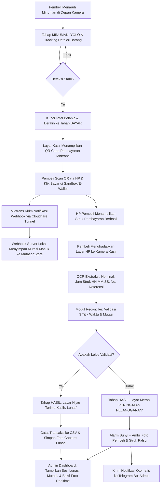

# Panduan Lengkap: Sistem Rekonsiliasi, QRIS Midtrans, & Deteksi Pelanggaran

Dokumen ini menjelaskan arsitektur, alur logika, struktur kode, dan panduan menjalankan sistem **Kasir Kulkas Kejujuran** (*Honesty Smart Fridge*) dengan verifikasi **OCR Bukti Transfer**, **Integrasi Payment Gateway Midtrans (QRIS)**, **Webhook Server Lokal**, dan **Sistem Rekonsiliasi Mutasi Anti-Kecurangan**.

---

## 1. Latar Belakang & Masalah

Pada sistem kulkas kejujuran berbasis scan QRIS (terutama QRIS statis), pembeli umumnya mengambil barang lalu melakukan transfer mandiri. Tanpa verifikasi otomatis yang ketat, terdapat beberapa celah kecurangan:

1. **Replay Attack (Screenshot Lama)**: Pembeli menunjukkan screenshot struk pembayaran kemarin atau tadi pagi ke kamera kasir.
2. **Fake Screenshot (Struk Palsu/Editan)**: Pembeli mengedit nominal, status, atau jam pada aplikasi transfer tanpa ada uang yang benar-benar masuk ke rekening.
3. **Double-Spending (Satu Struk Dipakai Ulang)**: Dua pembeli bergantian menggunakan satu bukti transfer yang sama untuk mengambil dua barang berbeda.
4. **Underpayment (Kurang Bayar)**: Total belanja Rp 15.000, namun pembeli hanya mentransfer Rp 5.000.

Untuk menyelesaikan masalah ini secara efisien tanpa memerlukan hardware mahal, sistem menggunakan metode **Triangulasi Waktu & Rekonsiliasi Mutasi Real-Time**.

---

## 2. Arsitektur & Alur Kerja Sistem

### 2.1 Diagram Alur Transaksi Kasir



### 2.2 Dashboard Admin & Live Monitoring Web UI

Sistem dilengkapi dengan **Dashboard Web Admin Realtime** yang dapat dibuka di browser laptop kasir maupun dari jarak jauh via smartphone / internet:
- **URL Lokal**: `http://localhost:8091/admin`
- **URL Publik (Cloudflare)**: `https://kulkas.ruwwww-thesis.my.id/admin`

Fitur Dashboard Admin:
1. **Live KPI Cards**: Menampilkan Total Sesi Transaksi, Transaksi Lunas Terverifikasi, Persentase Fraud/Pelanggaran, dan Total Pendapatan Tercatat.
2. **Tabel Sesi Transaksi**: Daftar seluruh transaksi kasir lengkap dengan filter (*Semua*, *Lunas*, *Pelanggaran*, *Timeout*).
3. **Modal Viewer Capture Foto**: Admin dapat mengklik tombol **Foto** pada baris transaksi untuk melihat foto resolusi penuh wajah pembeli dan struk yang ditunjukkan.
4. **Feed Mutasi Masuk**: Menampilkan riwayat dana yang masuk via Midtrans / Bank secara transparan beserta status klaim mutasi.
5. **Auto-Refresh (Live Sync)**: Dashboard otomatis melakukan sinkronisasi data setiap 2 detik tanpa perlu me-reload halaman.

---

## 3. Logika Rekonsiliasi & Deteksi Pelanggaran

Sistem melakukan evaluasi melalui 4 lapisan pengecekan di `src/reconcile.py`:

### Lapisan 1: Validasi Nominal Dasar
$$\text{Nominal OCR} \ge \text{Total Tagihan}$$
Jika pembeli membayar kurang dari total harga barang, transaksi ditolak dengan kategori:
`PELANGGARAN_KURANG_BAYAR`.

### Lapisan 2: Anti-Double-Spending Nomor Referensi
Setiap nomor referensi transaksi (RRN / Ref ID) yang terbaca dari OCR dicatat ke dalam himpunan `used_refs`. Jika nomor referensi yang sama muncul kembali pada transaksi berikutnya, transaksi ditolak:
`PELANGGARAN_DOUBLE_SPEND_REF`.

### Lapisan 3: Triangulasi Waktu (Anti-Screenshot Lama)
Kamera kasir membandingkan jam yang tertera pada struk HP ($T_{\text{struk}}$) dengan jam sistem laptop kasir ($T_{\text{kamera}}$):
$$|T_{\text{kamera}} - T_{\text{struk}}| \le \Delta t_{\text{toleransi}} \quad (\text{default: } 180 \text{ detik / 3 menit})$$
Jika pembeli menunjukkan screenshot lama (misalnya transfer tadi pagi atau kemarin), selisih waktu akan jauh melebihi 180 detik, sehingga sistem langsung memicu:
`PELANGGARAN_TIMESTAMP_KADALUARSA`.

### Lapisan 4: Pencocokan Mutasi Rekening Masuk (Anti-Struk Palsu)
Pada mode ketat (`--require-mutation`), kasir mencocokkan struk dengan mutasi dana masuk yang diterima oleh webhook lokal:
1. Nominal mutasi $M_{\text{amount}} \ge \text{Total Tagihan}$.
2. Waktu dana masuk $T_{\text{mutasi}}$ harus berdekatan dengan jam struk $T_{\text{struk}}$ dan jam scan $T_{\text{kamera}}$ ($|T_{\text{mutasi}} - T_{\text{struk}}| \le \Delta t$).
3. Mutasi belum pernah diklaim sebelumnya (`claimed == False`).

Jika struk tampak meyakinkan tetapi tidak ada dana masuk di mutasi pada rentang waktu tersebut (misal screenshot palsu/editan), sistem memicu:
`PELANGGARAN_MUTASI_NIHIL`.

---

## 4. Struktur Modul & Penjelasan Kode

```
yolo-bottle/
├── src/
│   ├── kasir_kulkas.py       # Aplikasi utama kasir (State Machine, UI, & Kamera)
│   ├── reconcile.py          # Logika rekonsiliasi waktu & mutasi rekening
│   ├── webhook_server.py     # Server HTTP lokal penangkap notifikasi Midtrans/Bank
│   ├── midtrans_pay.py       # Klien Midtrans Snap & QR generator OpenCV
│   ├── telegram_notify.py    # Notifikasi alert pelanggaran ke Telegram bot
│   ├── ocr_payment.py        # Ekstraksi teks & nominal dari struk HP
│   └── common.py             # Utilitas, loader .env, & format rupiah
├── scripts/
│   ├── 10_kasir_multiclass.ps1 # Shortcut menjalankan kasir kulkas
│   ├── 12_telegram_bot.ps1     # Uji coba & status Telegram Bot
│   ├── 13_midtrans.ps1         # Uji coba transaksi Midtrans & cek status
│   └── 14_webhook_tunnel.ps1   # Uji coba & simulasi webhook mutasi lokal
├── .env                      # Kredensial Midtrans & Telegram (lokal)
└── mutasi.jsonl              # Log riwayat mutasi dana masuk
```

### 1. `src/reconcile.py`
- **`parse_receipt_datetime(texts)`**: Membaca tanggal dan jam (`HH:MM:SS`) dari baris teks OCR m-Banking Indonesia (BCA, Livin Mandiri, BRI, GoPay, Dana, ShopeePay) menggunakan regex.
- **`MutationStore`**: Menyimpan mutasi masuk di memori dan meng-append secara persisten ke `mutasi.jsonl`.
- **`Reconciler.verify(...)`**: Fungsi penentu keputusan transaksi berdasarkan nominal, tanggal struk, dan ketersediaan mutasi.

### 2. `src/webhook_server.py`
- Server HTTP multithread berbasis Python standard library (`http.server`).
- **Endpoint `POST /webhook/midtrans`**: Menerima notifikasi resmi dari Midtrans, memvalidasi tanda tangan digital **SHA-512** (`order_id + status_code + gross_amount + server_key`), dan menyimpan mutasi saat status bernilai `settlement` atau `capture-accept`.
- **Endpoint `POST /webhook/manual`**: Menerima injeksi mutasi manual untuk pengujian simulasi.
- **Endpoint `GET /health` & `GET /mutasi`**: Healthcheck dan inspeksi mutasi aktif.

### 3. `src/midtrans_pay.py`
- Menangani komunikasi ke Midtrans API (Sandbox & Production).
- **`create_snap_transaction()`**: Membuat tiket transaksi pembayaran.
- **`generate_qr_image()`**: Menghasilkan gambar matriks QR Code (BGR) tajam berukuran 180x180 px menggunakan modul bawaan `cv2.QRCodeEncoder` tanpa dependensi library eksternal.

### 4. `src/kasir_kulkas.py`
- Menjalankan siklus kasir kulkas:
  - **`MINUMAN`**: YOLO mendeteksi botol minuman dan mengakumulasi harga menu.
  - **`BAYAR`**: Menampilkan kartu QR Code di layar, memulai background polling status Midtrans, sekaligus mengaktifkan OCR kamera untuk membaca layar HP pembeli.
  - **`HASIL`**: Jika valid, menyapa pembeli dan mencatat ke `transaksi.csv`. Jika terjadi pelanggaran, memicu alarm, menyimpan foto bukti bayar, dan menembak pesan peringatan ke Telegram.

---

## 5. Konfigurasi Lingkungan (`.env`)

Pastikan file `.env` di root direktori proyek berisi konfigurasi berikut:

```env
# Telegram Bot (Notifikasi Pelanggaran)
TELEGRAM_BOT_TOKEN=<token-bot-telegram>
TELEGRAM_CHAT_ID=<chat-id-tujuan>

# Payment Gateway Midtrans (Sandbox)
MIDTRANS_MERCHANT_ID=<merchant-id>
MIDTRANS_CLIENT_KEY=<client-key>
MIDTRANS_SERVER_KEY=<server-key>
MIDTRANS_IS_PRODUCTION=false
```

---

## 6. Panduan Menjalankan Sistem

### Langkah 1: Aktifkan Tunnel Cloudflare
Agar Midtrans di internet dapat mengirimkan webhook ke server lokal port `8091`:
```powershell
cloudflared.exe tunnel run --token <token-cloudflared-anda>
```
*Tunnel akan menghubungkan domain publik `https://kulkas.ruwwww-thesis.my.id` ke `http://localhost:8091`.*

### Langkah 2: Daftarkan Webhook di Dashboard Midtrans
1. Buka [Midtrans Sandbox Dashboard](https://dashboard.sandbox.midtrans.com).
2. Masuk ke menu **Settings > Configuration**.
3. Di kolom **Payment Notification URL**, isi:
   ```text
   https://kulkas.ruwwww-thesis.my.id/webhook/midtrans
   ```
4. Klik **Save Changes**.

### Langkah 3: Jalankan Aplikasi Kasir Kulkas
```powershell
# Mode Standar (Otomatis menyalakan deteksi YOLO, OCR, QR Midtrans, & Webhook port 8091)
.\scripts\10_kasir_multiclass.ps1

# Mode Ketat (Wajib ada mutasi masuk rekening yang cocok sebelum dinyatakan lunas)
.venv\Scripts\python.exe src\kasir_kulkas.py --require-mutation --tolerance-sec 180
```

---

## 7. Panduan Skenario Pengujian (Untuk Demo)

### Skenario A: Transaksi Normal Berhasil (Happy Path)
1. Hadapkan botol minuman (misal *Teh Pucuk*) ke kamera laptop.
2. Saat layar masuk ke tahap `BAYAR`, scan kartu QR Code di layar kasir menggunakan kamera HP penguji.
3. Di HP, pilih **ShopeePay** atau **GoPay** > klik tombol **Simulate / Bayar**.
4. Di HP akan muncul struk hijau: *"Pembayaran Berhasil — Rp 10.000 — [Jam Sekarang]"*.
5. Hadapkan layar HP tersebut ke webcam laptop kasir.
6. Kasir memvalidasi nominal dan jam struk, mencocokkannya dengan mutasi Midtrans, lalu berbunyi:
   **`"Terima kasih! Pembayaran pas"`** (Layar hijau).

---

### Skenario B: Uji Coba Screenshot Lama (Replay Attack)
1. Taruh minuman di depan kamera hingga masuk ke tahap `BAYAR`.
2. Jangan bayar; hadapkan HP yang menampilkan gambar struk transfer kemarin / tadi pagi (> 3 menit yang lalu).
3. Kasir membaca jam struk yang sudah kadaluarsa.
4. **Hasil**:
   - Layar merah: **`PERINGATAN! TIMESTAMP KADALUARSA`**.
   - Alarm berbunyi.
   - Foto wajah pembeli dan foto struk lama otomatis dikirimkan ke **Telegram Bot** Anda.

---

### Skenario C: Uji Coba Struk Palsu / Editan (Mutasi Nihil)
1. Jalankan kasir dengan flag `--require-mutation`.
2. Hadapkan minuman hingga masuk tahap `BAYAR`.
3. Tunjukkan struk transfer yang jamnya sudah diedit sesuai jam sekarang, tetapi pembeli tidak benar-benar mentransfer uang ke Midtrans/Bank.
4. **Hasil**:
   - Kasir mengecek database mutasi lokal, tidak menemukan dana masuk Rp 10.000 pada jam tersebut.
   - Layar merah: **`PERINGATAN! MUTASI NIHIL`**.
   - Foto pembeli disimpan dan dilaporkan ke Telegram.

---

### Skenario D: Uji Coba Penggunaan Ulang Struk (Double-Spending)
1. Setelah seseorang berhasil membayar di Skenario A, orang lain mengambil minuman baru dan mencoba menunjukkan struk yang sama persis.
2. **Hasil**:
   - Sistem mendeteksi ID mutasi / referensi struk sudah berstatus `claimed == True`.
   - Layar merah: **`PERINGATAN! DOUBLE SPEND`**.
   - Dilaporkan ke Telegram.

---

## 8. Arsitektur Database & Reset ke Fresh State (Titik 0)

Untuk keperluan operasional persisten, pelaporan, dan kemudahan demo berulang, sistem dilengkapi dengan manajemen database SQLite (`kulkas.db`) dan mekanisme reset **Fresh State**.

### 8.1 Skema Database SQLite (`kulkas.db`)
Database beroperasi dengan mode `WAL` (Write-Ahead Logging) agar aman diakses secara konkuren oleh kasir, webhook server, dan dashboard:
- `products`: Katalog produk, harga, dan stok awal (tersinkronisasi dari `menu.csv`).
- `transactions`: Log sesi transaksi kasir (status `OK`/`PELANGGARAN`, nominal belanja, nominal struk, waktu kasir, path foto bukti).
- `transaction_items`: Item minuman yang dibeli dalam tiap sesi.
- `mutations`: Log seluruh dana masuk dari webhook Midtrans/manual.
- `fraud_logs`: Catatan investigasi fraud (alasan pelanggaran, bukti foto, status rekonsiliasi).

### 8.2 Cara Mengembalikan Sistem ke Fresh State (Reset Titik 0)
Sebelum melakukan demo baru atau pengujian dosen/auditor, Anda dapat mengosongkan seluruh data uji coba tanpa kehilangan data lama (data lama otomatis diarsipkan):

```powershell
# Reset sistem ke kondisi fresh (data lama otomatis di-backup ke archive/backup_YYYYMMDD_HHMMSS)
powershell -ExecutionPolicy Bypass -File scripts\15_reset_fresh_state.ps1

# Atau gunakan Python langsung
.venv\Scripts\python.exe src\db.py --fresh
```

Aksi yang dilakukan saat Fresh State:
1. Membuat snapshot cadangan di `archive/backup_<timestamp>/`.
2. Memindahkan semua foto di folder `pelanggaran/` ke folder arsip.
3. Mengosongkan file `transaksi.csv` (hanya menyisakan header kolom).
4. Mengosongkan file `mutasi.jsonl` (0 baris).
5. Me-reset tabel `transactions`, `transaction_items`, `mutations`, `fraud_logs` di `kulkas.db` menjadi 0 data.
6. Menyinkronkan ulang master produk dari `menu.csv`.

